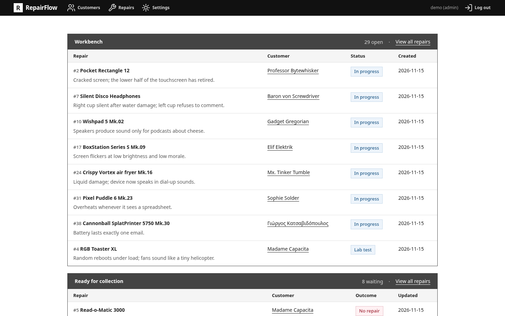
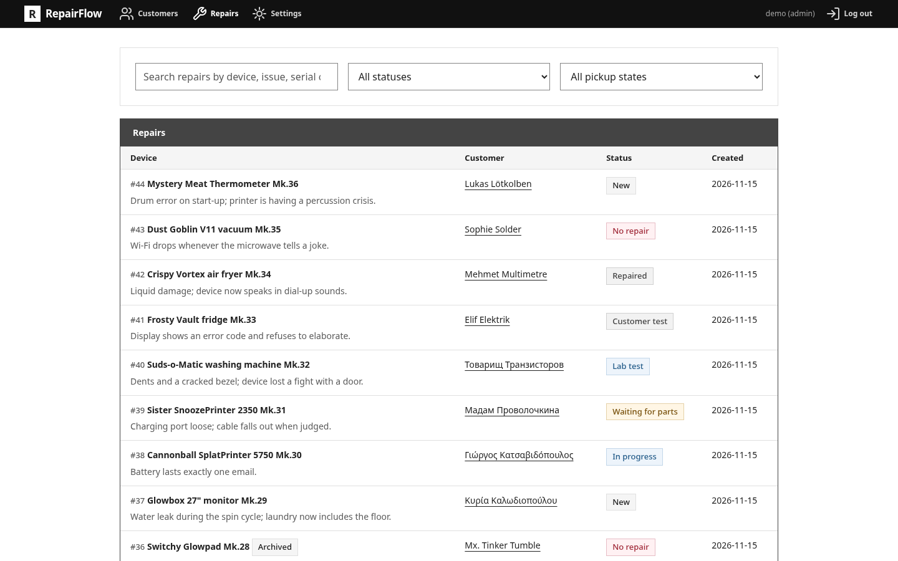
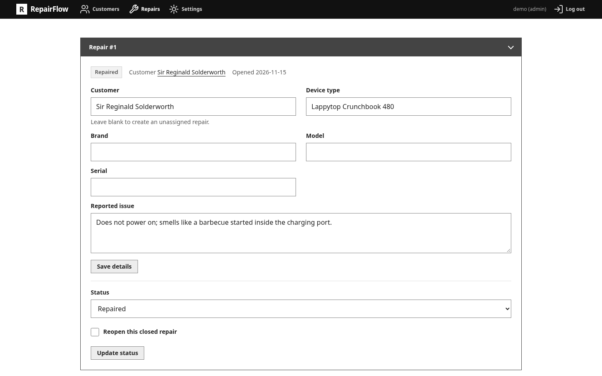
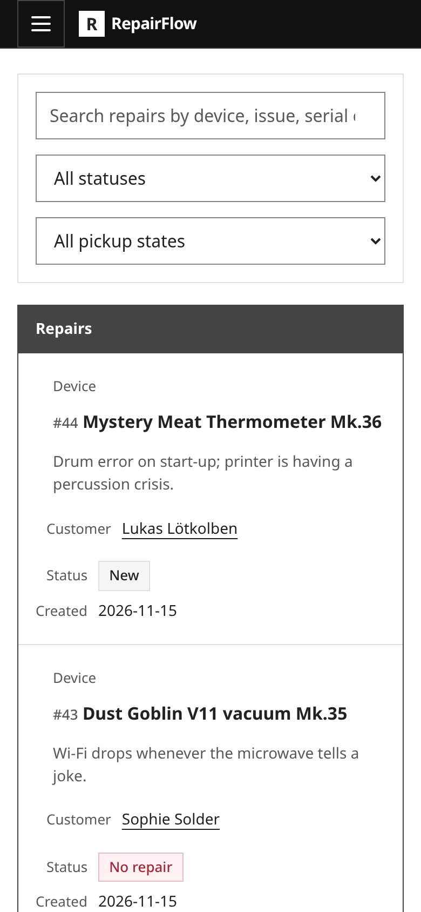
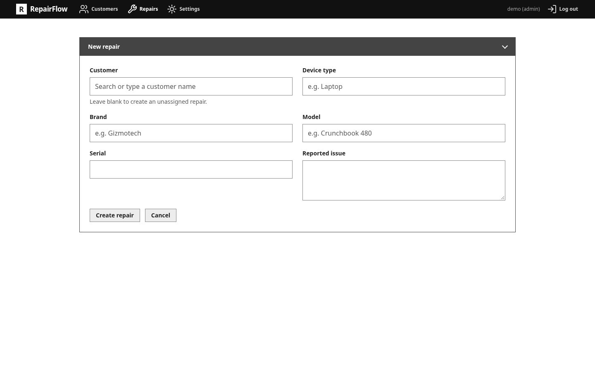

# RepairFlow

**Keep repair work, customer history and workshop evidence in one place, under your control.**

RepairFlow is a local-first, privacy-first workspace for small repair shops. The web UI is the human
interface; the scriptable CLI makes the same workflows accessible to automation and optional AI
agents. Both ship in one static Go executable. Records live in SQLite; uploaded photos and documents
are kept as original files.

**Your data remains yours.** Your records and files stay in your workspace, under your ownership and
at your disposal. RepairFlow requires no cloud account, database server, telemetry, AI runtime or
outbound network connection. If you choose to use an AI agent, it can work through the CLI; no AI
service is built in or required.

## A look at the interface

Screenshots from the demo workspace (`init --demo`), which carries entirely synthetic records.







<p align="center">
  
</p>

The new-repair form with the customer picker:



## What it does

- Tracks customers, devices and repairs, including repairs not yet assigned to a customer.
- Moves work through seven repair stages, with an explicit audit trail for reopening finished work.
- Keeps dated work, test, customer-contact, handover and note entries; corrections retain their
  previous revisions.
- Records whole-piece parts in the web repair page; the CLI retains versioned estimates for compatibility.
- Stores original attachments with SHA-256 hashes, captions, galleries and links to log entries.
- Separates pickup from repair stage and archives old records without destroying their history.
- Provides admin, technician and viewer accounts for the web interface.
- Creates verified backup archives and supports signed binary updates, with an optional GitHub
  download script.
- Runs as a foreground process, a systemd user service or an OpenRC service.

RepairFlow does **not** provide payment accounting, stock control, tax invoices, cloud sync or
multi-workshop replication. Estimates are not payments, and part lines are not an inventory ledger.

## Project status

RepairFlow is in pre-release development and workshop evaluation. It is built and tested on Linux
**amd64** and **arm64**. Other operating systems and architectures may work or be straightforward to
port, but they are **not tested yet** and are not supported targets.

Pre-releases promise **no compatibility between versions**: schema, CLI flags and JSON, and web
routes may change, and a workspace may need to be recreated rather than migrated. Take a verified
backup before opening it with a newer binary, and use prereleases on disposable workspaces.

## License

Copyright (C) 2026 RepairFlow contributors.

RepairFlow is licensed under **AGPL-3.0-only**; see [LICENSE](LICENSE). This includes source-sharing
obligations for modified versions offered through a network interface. The compiled dependencies
are BSD-3-Clause and MIT; `make license-check` verifies that inventory and writes
`dist/licenses/THIRD_PARTY_NOTICES.md`. Release archives include that generated notice document.

### Verify a release

Release artifacts are signed with the Ed25519 key
`dfefd2ea87dd10bbc4bef626ba1422aed3d383e1789ef5546fa3d534cb855426`. Each release ships
`SHA256SUMS` and `SHA256SUMS.sig`; authenticate the list before extracting anything, then check only
the archive you downloaded. `repairflow update verify --file SHA256SUMS --signature SHA256SUMS.sig`
uses the key embedded in an installed binary; the pre-install `openssl` recipe is in
[the install guide](docs/INSTALL.md#from-a-release-archive). A bare checksum pass proves only that a
file matches a list that arrived with it.

For an existing installation, `repairflow-update` checks the latest stable release without changing
anything. After the backup/stop checks in [the upgrade guide](docs/DEPLOY.md#upgrade), use
`repairflow-update --apply --restart` to apply it and restart the default service. An exact tag,
such as `v0.2.0-rc6`, selects a prerelease.

## Quick start

### Try the demo

From a source checkout, install **Go 1.27** and run:

```bash
make build
./scripts/run-demo.sh
```

The short public demo path is also available from the repository root:

```bash
git clone https://github.com/obionar/repairflow
cd repairflow/demo
./run-demo.sh
```

The `demo/` launcher uses an existing binary, builds from source when Go is
available, or downloads and checksum-verifies the matching Linux release into
`demo/bin/`. It creates a temporary synthetic workspace, serves it and removes
it on exit. For a persistent contributor workspace use `cd demo && ./dev.sh`;
reset it with `./reset.sh`. No database is committed.

To try the demo without Go, initialize a temporary workspace explicitly:

```bash
demo_home=$(mktemp -d)
REPAIRFLOW_NEW_PASSWORD=repairflow repairflow --home "$demo_home" init --demo --demo-user demo
repairflow --home "$demo_home" serve
```

The explicit `--demo-user` is required for a usable login; without it the demo workspace has no
account under `auth_required=true`. Remove `$demo_home` when finished.

Open <http://127.0.0.1:8091/login> and sign in with:

```text
Username: demo
Password: repairflow
```

The launcher creates a temporary synthetic workspace and deletes it when you press **Ctrl+C**.
Never use these public demo credentials for a real workspace.

### Start a real workspace

The default install is `~/.local/bin/repairflow`, owned by you, so installing and updating need no
`sudo`; `REPAIRFLOW_PREFIX=/usr/local` gives the shared, root-owned layout instead. The workspace
remains `~/.repairflow` unless you pass `--home` or set `REPAIRFLOW_HOME`.

After [installing the executable](docs/INSTALL.md) as `repairflow`:

```bash
repairflow init
export REPAIRFLOW_NEW_PASSWORD='use-a-long-unique-password'
repairflow user add admin --role admin
unset REPAIRFLOW_NEW_PASSWORD
repairflow serve
```

Open <http://127.0.0.1:8091/login>. The default workspace is `~/.repairflow`; use `--home PATH` or
`REPAIRFLOW_HOME` to choose another location. `init` creates the configuration and initializes the SQLite database without creating records or
accounts, so `doctor` is healthy directly afterwards. Installing a new binary from source only
validates existing configuration; it does not open or migrate the database. An outdated schema is
refused by ordinary commands; migrate explicitly with `init --backup ABSOLUTE_PATH` after a verified
backup and stopping the service. For upgrades, take a verified backup and stop old writers first, as
[the deployment guide](docs/DEPLOY.md#upgrade) describes. See [the installation guide](docs/INSTALL.md)
for release verification, roles and troubleshooting.

## Documentation

- [Install and first run](docs/INSTALL.md) — binary installation, demo, accounts and initial setup.
- [Daily use](docs/USAGE.md) — web and CLI workflows, attachments, languages and backups.
- [Deployment](docs/DEPLOY.md) — services, remote access, workspace moves, upgrades and removal.
- [CLI contract](docs/CLI-CONTRACT.md) — commands, JSON output, errors and exit codes.
- [Security](docs/SECURITY.md) — protections, trust boundaries and operational limits.
- [Translations](docs/TRANSLATIONS.md) — language coverage and translation workflow.
- [Development](docs/DEVELOPMENT.md) — build, test and contribution workflow.
- [Workshop bench testing](docs/BENCH-TEST.md) — isolated hardware/workflow and recovery checks.
- [Architecture](docs/ARCHITECTURE.md) — components, domain rules, schema and failure handling.
- [Project map](docs/PROJECT_MAP.md) — source packages and contract locations.

Coding agents should start with [AGENTS.md](AGENTS.md) and the task-specific guides in
[`skills/`](skills/).
